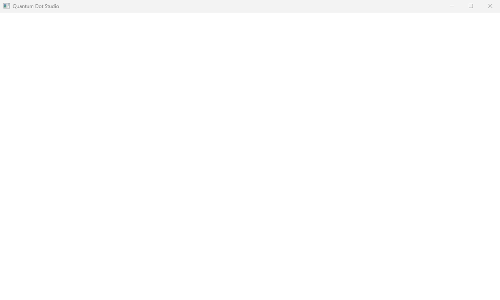
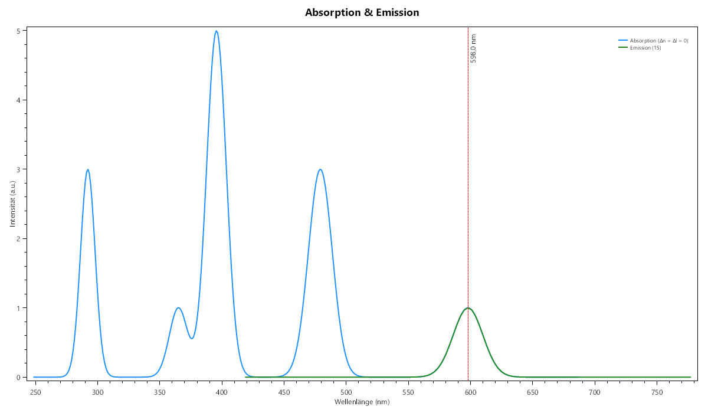
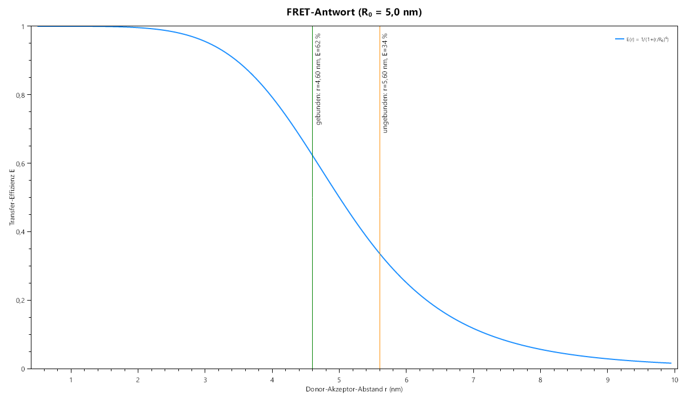
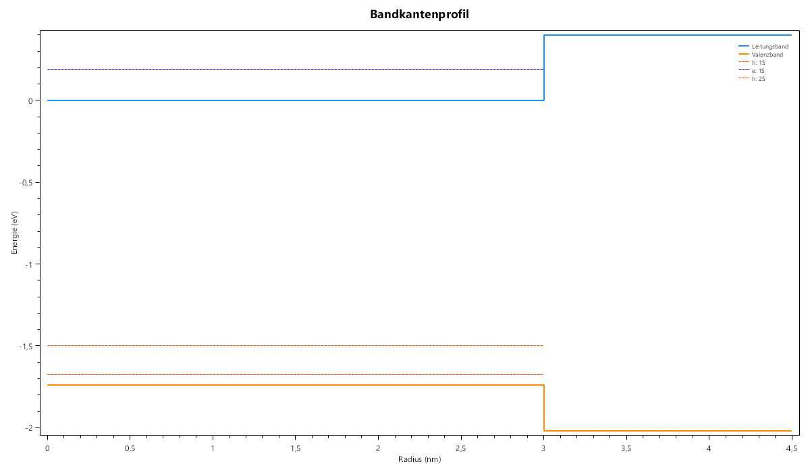

# Quantum Dot Studio

Interactive 3D simulation and sensor-design workbench for semiconductor quantum
dots — C# / .NET 10 / WPF.



## What it does

Quantum Dot Studio turns a quantum dot from a textbook formula into a designable
object: pick a material and radius, get the electronic structure, the optical
spectrum and a 3D view — then extend it into a core/shell heterostructure, a
chemical sensor, and finally ask the Machbarkeit engine how likely that sensor
is to actually work.

**Physics engine**

- Spherical quantum well for both regimes: infinite well for bare dots
  (numerically exact Bessel zeros — no asymptotic approximations) and a
  finite-well solver for core/shell dots (`k·cot(kR) = −κ`, bisection per state).
- Full Brus equation including the leading-order Coulomb term; CdSe at 3 nm
  reproduces the Yu et al. (2003) sizing curve.
- Core/shell physics: band alignment from electron affinities, lattice-mismatch
  strain and Matthews–Blakeslee critical thickness.
- Selection-rule optical spectrum: allowed transitions (Δn = Δl = 0) with
  degeneracy-based oscillator strengths (1S : 1P : 1D = 1 : 3 : 5) — absorption
  series plus the 1S emission line, anchored exactly to the Brus gap.
- Environment model: temperature shifts the band gap via Varshni's equation
  (referenced to 300 K — the standard environment reproduces the legacy
  numbers exactly), solvents screen the Coulomb term
  (ε_eff = (2·ε_dot + ε_sol)/3, CRC Handbook dielectrics), and the pH checks
  each ligand's stability window inside the feasibility engine.



**Sensor platform** (four transduction modes)

| Mode | Physics | Readout |
|---|---|---|
| FRET | E = 1/(1+(r/R₀)⁶) | ratiometric donor/acceptor contrast |
| Quenching | Stern–Volmer I/I₀ = 1/(1+K_SV[A]) | intensity drop + LOD |
| Charge | Nernst 59.16 mV/decade | spectral shift vs. pH |
| PET | redox energetics vs. CB edge | on/off quench fraction |

Ligands and analytes are JSON databases — no code changes to add one.



**Feasibility engine (Machbarkeit)**

Scores a complete sensor design on six physics factors (emission window,
strain, quantum-yield proxy, transduction, stability, bioconjugation) plus a
per-mode selectivity term for interferents, with a weighted geometric mean, runs a seeded Monte Carlo
(N ≈ 2000) through the full Brus recomputation, and reports a median success
probability with a 5–95 % band and factor variance decomposition — it tells you
which parameter to fix first. Five literature-anchored templates (Xiang & Tang
2017 acetamiprid-FRET, Li 2013 Pb²⁺, Daramola 2020 pH, glucose-GOx, Goldman 2002
IgG) are validated: the engine ranks each published design above its known
failure mode, and the Brus pipeline reproduces published wavelengths within ±20 %.

**3D visualization**

Zinc-blende lattice cut-outs with per-element colors (10 nm CdSe ≈ 151 000
atoms), 1S and 1P probability clouds, merged-mesh rendering with tiered LOD —
benchmark-verified: ~13 s (per-atom, UI thread) → ~1.1 s (merged, background).

**LaTeX export**

One click produces a complete `.tex` report — model equations, parameter
tables, results, an emission-color box, an optional core/shell chapter, the
optional feasibility chapter and an embedded 3D screenshot. Every report layout
is compile-verified with real pdflatex.



## Quality

- 173 xUnit tests — physics identities, solver convergence, database deployment,
  MVVM pipeline (recalc staleness guard, frozen-mesh threading), sensor mode
  response functions, literature-validation ranking.
- CI on every push/PR: build + full test suite (windows-latest, .NET 10).
- A dedicated benchmark console project measures renderer construction time —
  performance claims in this README are measured, not estimated.

## Getting started

Requires Windows 10/11 and the [.NET 10 SDK](https://dotnet.microsoft.com/download/dotnet/10.0).

```bash
cd src
dotnet run --project QuantumDotStudio.WPF      # build + launch the app
dotnet test QuantumDotStudio.slnx               # run the test suite
dotnet run --project QuantumDotStudio.Bench -c Release   # renderer benchmark
```

## Architecture

| Project | Responsibility |
|---|---|
| `Core` | Domain models, JSON material/ligand/analyte/template databases, sensor + feasibility physics |
| `Solver` | Quantum solver (Bessel zeros, Brus, finite well), band alignment, strain, feasibility engine, service orchestration |
| `Renderer` | Helix-Toolkit 3D rendering (merged meshes, LOD, frozen models) |
| `Reports` | LaTeX report generator |
| `WPF` | MVVM UI — simulation, sensor and feasibility views, OxyPlot charts |
| `Tests` | 173 xUnit tests |
| `Bench` | Renderer performance benchmark |

Dependency direction: `Core → Solver → {Renderer, Reports, WPF}`, with `Tests`
and `Bench` on top. All heavy work runs on background threads behind a staleness
guard; the UI thread only assigns frozen results.

## Extending

Every dataset is JSON — materials (`materials.json`), ligands, analytes, sensor
templates and feasibility weights all live in `src/QuantumDotStudio.Core/Data/`
and deploy automatically. Adding a material or ligand requires no code change.

The physics documentation lives in
[docs/Wiki/BackendAndCalculations.md](docs/Wiki/BackendAndCalculations.md)
(models, formulas, simplifications), the development plan in
[docs/ROADMAP.md](docs/ROADMAP.md) — all four phases (core/shell, sensor modes,
probability engine, literature validation) are complete.